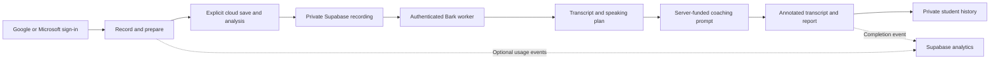

# Cloud pilot

Neeley Dress Rehearsal is moving toward funded speech transcription and coaching with one free experience for all users. The repository contains a configurable cloud client, Supabase backend, and Bark worker. The current GitHub Pages site continues in local mode until production configuration is supplied and launch checks pass. The plugin is unchanged. The admin dashboard and all paid-plan work are deferred.

## Deployment status — October 26, 2026

The Supabase foundation is deployed to the free project `cnqpaamclpdzdmyuqhuz`: the migration, private storage policies, and `rehearsal-api` Edge Function are live. The gateway has a **$1 daily admission allowance**, reserving $0.075 per speech request and $0.060 per coaching request. This admits seven complete new rehearsals daily across all users before other activity, with no reset of existing test debits. Limits remain 10 requests per student per day, 10 recordings per student, and 40 recordings total. These reservations are admission controls, not measured provider charges. Server-funded Bark 3.0 Plus and **OpenAI `gpt-6-luna`** coaching are configured.

The owner successfully signed into the local cloud-mode build through Google and completed a real Supabase SDK upload, private history lookup, reopen, and replay. Email/password, phone, and anonymous authentication are disabled. Microsoft sign-in configuration is still pending; its button explains that Google is available.

The Modal worker is deployed behind proxy authentication, with Starter's **$30 gross usage budget and $0 net spend limit verified**. A 27.721875-second synthetic fixture transcribed in 61.220 seconds cold and 1.276 seconds warm; both matched the reference, including all `um`/`uh`, repeated `I, I`, and the ending. Missing proxy credentials and a wrong worker bearer returned 401; malformed WAV returned 422. See the worker README for the limits of this smoke test.

Before migration deployment, **35 database assertions passed** on this project in a rollback transaction; the test users, objects, and schema changes were confirmed removed. The deployed API then passed smoke checks: public configuration returned 200, signed-out history returned 401, a foreign origin returned 403, and an allowed-origin preflight returned 204.

The full browser transcription/coaching flow passed in the owner's Google session using a privately saved 27.7-second fixture. Bark matched the reference transcript, including fillers. OpenAI returned a 48/100 rating, five annotations, and three of four target points, correctly identifying the missing invitation. Word statistics showed two `um`, two `uh`, one filler `like`, and two non-filler uses of `like`. Reopening the completed report from private history returned the same transcript and feedback. This fixture does not establish accuracy across student recordings.

GitHub's two public build variables are configured for the hosted experience. Production-origin CORS and backend availability checks passed. Every Pages release still needs a successful deployment and a production sign-in smoke check. Microsoft setup and broader pilot tests remain outstanding. All users share one free experience; operational quotas are capacity controls, not paid plans.

## Product layers

| Layer | Responsibility |
| --- | --- |
| 1 — User interface | The Neeley student web app hosted on GitHub Pages. |
| 2 — Compute | The authenticated Edge gateway, deployed Modal-hosted Bark transcription, and server-configured OpenAI `gpt-6-luna` coaching. The owner browser flow passed with a synthetic fixture. |
| 3 — Data | Supabase authentication, private recordings, transcripts and report history, and optional usage metrics. |
| 3.5 — Administration | A future separate metrics/admin service; deferred from this pilot. |
| 4 — Security | Access controls, private storage, server-held credentials, input validation, spending caps, and verification across every layer. |

## Rehearsal flow



The browser records audio and extracts rubric text. Cloud mode starts upload through a disclosed transcription or analysis action; ordinary recording and replay do not upload audio. The browser never receives the coaching provider key, worker token, Modal proxy secret, or Supabase server secret. Speech and coaching processing consume the private content required for that operation. Usage events contain only allowlisted names, sections, session IDs, and bounded active-time values.

## Deployment components

| Component | Location | Deployment |
| --- | --- | --- |
| Student app | `public/`, `lib/hosted-service.mjs` | Existing GitHub Pages workflow |
| Database and private storage policies | `supabase/migrations/` | Supabase free project |
| Authenticated API | `supabase/functions/rehearsal-api/` | Supabase Edge Functions |
| Bark Plus inference | `cloud/speech-worker/` | Separate GPU service; Modal adapter included |

Supabase's free database and authentication plan does not provide a GPU. [Edge Function limits](https://supabase.com/docs/guides/functions/limits) rule out loading Bark there. The worker is our own transcription service built around existing open weights, not a newly trained foundation model. See [cost research](cloud-costs.md) for the ElevenLabs comparison and assumptions.

## Account setup

1. Create the free Supabase organization and project. Save its database password privately. Disable default grants for new tables and enable automatic RLS where offered.
2. Register Google and Microsoft OAuth applications using the callback URL Supabase supplies. Enable only Google and Azure/Microsoft in Supabase Auth. Disable Email, Phone, and Anonymous sign-in; omitting buttons alone does not disable those APIs.
3. Add exact redirect URLs for the student site and explicit local development URLs. Avoid wildcard production redirects. Request only basic identity/email scopes; Microsoft requires the `email` scope. School-managed Microsoft accounts may require tenant-admin approval.
4. Apply migrations, deploy the API, and configure allowed origins and server secrets. Follow `supabase/README.md` and the worker README. Never put server secrets in public GitHub variables or `VITE_` values.
5. Keep Modal on **Starter**, which currently includes $30/month in compute. The Workspace usage budget is **$30 gross** and its spend limit is **$0 net**, both verified in Usage & Billing. Preserve these caps and keep worker credentials only in the API server environment. These Modal caps do not cover external coaching charges. The separate gateway admission allowance is currently $1/day for demo tests. [Modal budgets](https://modal.com/docs/guide/budgets), [pricing](https://modal.com/pricing)
6. The demo uses server-configured OpenAI `gpt-6-luna`. Keep its key server-side and validate evidence-based ratings and annotations on real pilot examples. Other documented providers are supported alternatives, not the selected demo service.

Primary setup guides: [Google](https://supabase.com/docs/guides/auth/social-login/auth-google), [Microsoft](https://supabase.com/docs/guides/auth/social-login/auth-azure).

Google is configured. For a pilot requesting only `openid`, email, and profile, Google's **Testing exception** allows users outside the test-user list without the seven-day authorization expiry. Extra scopes remove that exception, and organization administrators can still block sign-in. A paid custom domain or published brand is not required for this basic pilot flow. Production branding has separate homepage, privacy, and verification requirements; **Publish branding** is distinct from Audience's **Publish app**. [Google audience rules](https://support.google.com/cloud/answer/15549945?hl=en), [branding requirements](https://support.google.com/cloud/answer/15549049?hl=en).

Complete the pending Microsoft setup at [Microsoft Entra — App registrations](https://portal.azure.com/#blade/Microsoft_AAD_IAM/ActiveDirectoryMenuBlade/RegisteredApps), then **New registration**. Use a Web application with callback `https://cnqpaamclpdzdmyuqhuz.supabase.co/auth/v1/callback` and select supported account types deliberately. This does not itself establish an approved TCU integration. Store the generated client secret only in Supabase Auth. [Microsoft registration guide](https://learn.microsoft.com/en-us/entra/identity-platform/quickstart-register-app).

## Build and enable

The student build reads root `.env.local` for development. It is ignored by Git:

```text
VITE_SUPABASE_URL=https://YOUR_PROJECT.supabase.co
VITE_SUPABASE_PUBLISHABLE_KEY=sb_publishable_YOUR_PUBLIC_KEY
```

These are public identifiers, not secret credentials. Student builds stay local when both are absent. Partial configuration fails visibly instead of silently changing processing mode.

```text
pnpm test
pnpm build
pnpm exec supabase start
pnpm exec supabase db reset
pnpm test:db
```

Database commands require Docker. The cloud-pilot workflow runs database checks on an isolated GitHub runner, never the production database. No admin application, tier selector, or payment system is included.

After launch checks pass, set GitHub repository Variables `VITE_SUPABASE_URL` and `VITE_SUPABASE_PUBLISHABLE_KEY` and rerun Pages deployment. Rollback removes both public variables and rebuilds the student site; it does not delete private Supabase data.

## Launch checks

- Both OAuth providers work; email/password, phone, and anonymous APIs are disabled.
- Students can save, reopen, replay, and delete their rehearsals. Other students and signed-out browsers cannot access them, including by guessing IDs or storage paths.
- A real cloud Bark rehearsal preserves important fillers and the complete ending. Measure cold and warm latency; browser benchmarks do not establish cloud performance.
- A funded coaching request produces validated ratings, annotations, and the existing report format.
- Expired sign-in, cancellations, timeouts, duplicate request IDs, concurrency, and budget exhaustion cannot bypass caps or reveal another student's data.
- Storage limits hold under concurrency. Monitor free-plan storage and egress before increasing the pilot cohort.
- Opting out sends no engagement events. Background and idle time are excluded. Retention denominators cover only observed, consenting students.
- Students cannot query another user's usage events. The pilot does not expose an admin analytics API.
- Secrets and student content do not appear in frontend assets, application logs, or Git history.

Mono 16 kHz PCM16 audio uses approximately 1.92 MB per minute, before metadata. A five-minute take is roughly 9.6 MB. Free storage is a pilot constraint, not unlimited capacity; set deletion practices and capacity limits before rollout.
