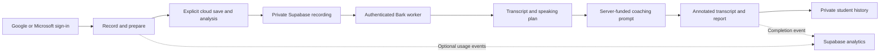

# Cloud pilot

Neeley Dress Rehearsal is moving toward funded speech transcription and coaching with one free experience for all users. The repository contains a configurable cloud client, Supabase backend, and Bark worker. The current GitHub Pages site continues in local mode until production configuration is supplied and launch checks pass. The plugin is unchanged. The admin dashboard and all paid-plan work are deferred.

## Deployment status — October 26, 2026

The Supabase foundation is deployed to the free project `cnqpaamclpdzdmyuqhuz`: the migration, private storage policies, and `rehearsal-api` Edge Function are live. The daily AI allowance remains **zero**. Only allowed browser origins have been configured for the gateway; no Bark worker credentials or coaching API key have been supplied. Email/password, phone, and anonymous authentication are disabled. Google and Microsoft app registrations and credentials remain to be configured.

Before migration deployment, **35 database assertions passed** on this project in a rollback transaction; the test users, objects, and schema changes were confirmed removed. The deployed API then passed smoke checks: public configuration returned 200, signed-out history returned 401, a foreign origin returned 403, and an allowed-origin preflight returned 204. These checks do not establish that OAuth, private browser uploads, or funded AI processing work end to end.

**There has been no frontend switch to cloud mode.** GitHub Pages continues to serve the existing local-processing experience while OAuth setup, real Storage upload tests, Bark deployment, coaching funding, and launch checks remain outstanding. All users will share one free experience; operational quotas are capacity controls, not paid plans.

## Product layers

| Layer | Responsibility |
| --- | --- |
| 1 — User interface | The Neeley student web app hosted on GitHub Pages. |
| 2 — Compute | The authenticated Edge gateway, Modal-hosted Bark transcription, and an external coaching LLM. The Bark worker and funded coaching connection still need deployment/configuration. |
| 3 — Data | Supabase authentication, private recordings, transcripts and report history, and optional usage metrics. |
| 3.5 — Administration | A future separate metrics/admin service; deferred from this pilot. |
| 4 — Security | Access controls, private storage, server-held credentials, input validation, spending caps, and verification across every layer. |

## Rehearsal flow



The browser records audio and extracts rubric text. Cloud mode starts upload through a disclosed transcription or analysis action; ordinary recording and replay do not upload audio. The browser never receives the coaching provider key, worker token, Modal proxy secret, or Supabase server secret. Speech and coaching processing consume the private content required for that operation. Usage events contain only allowlisted names, sections, session IDs, and bounded active-time values.

## Deployment components

| Component | Location | Deployment |
| --- | --- | --- |
| Student app | `public/`, `lib/hosted-service.mjs` | Existing GitHub Pages workflow |
| Database and private storage policies | `supabase/migrations/` | Supabase free project |
| Authenticated API | `supabase/functions/rehearsal-api/` | Supabase Edge Functions |
| Bark Plus inference | `cloud/speech-worker/` | Separate GPU service; Modal adapter included |

Supabase's free database and authentication plan does not provide a GPU. [Edge Function limits](https://supabase.com/docs/guides/functions/limits) rule out loading Bark there. The worker is our own transcription service built around existing open weights, not a newly trained foundation model. See [cost research](cloud-costs.md) for the ElevenLabs comparison and assumptions.

## Account setup

1. Create the free Supabase organization and project. Save its database password privately. Disable default grants for new tables and enable automatic RLS where offered.
2. Register Google and Microsoft OAuth applications using the callback URL Supabase supplies. Enable only Google and Azure/Microsoft in Supabase Auth. Disable Email, Phone, and Anonymous sign-in; omitting buttons alone does not disable those APIs.
3. Add exact redirect URLs for the student site and explicit local development URLs. Avoid wildcard production redirects. Request only basic identity/email scopes; Microsoft requires the `email` scope. School-managed Microsoft accounts may require tenant-admin approval.
4. Apply migrations, deploy the API, and configure allowed origins and server secrets. Follow `supabase/README.md` and the worker README. Never put server secrets in public GitHub variables or `VITE_` values.
5. Deploy the Bark worker with authentication before GPU startup. Add its URL and credentials only to the API server environment. No public compute allowance is enabled until a deliberate cap is set.
6. Configure one funded coaching provider key on the server. Choose a model based on coaching quality as well as price; validate evidence-based ratings and annotations on real pilot examples.

Primary setup guides: [Google](https://supabase.com/docs/guides/auth/social-login/auth-google), [Microsoft](https://supabase.com/docs/guides/auth/social-login/auth-azure).

The next account handoff starts at [Google Auth Platform — create OAuth client](https://console.cloud.google.com/auth/clients/create) and [Microsoft Entra — App registrations](https://portal.azure.com/#blade/Microsoft_AAD_IAM/ActiveDirectoryMenuBlade/RegisteredApps), then **New registration** for Microsoft. Use a Web application and the callback `https://cnqpaamclpdzdmyuqhuz.supabase.co/auth/v1/callback` for both. Configure Google's audience/branding first if prompted. Select Microsoft account types deliberately; sign-in with a school Microsoft account does not itself establish an approved TCU integration. Store the generated client secrets only in Supabase Auth. The registration links and steps are documented in the [Google setup guide](https://supabase.com/docs/guides/auth/social-sign-in/auth-google) and [Microsoft registration guide](https://learn.microsoft.com/en-us/entra/identity-platform/quickstart-register-app).

## Build and enable

The student build reads root `.env.local` for development. It is ignored by Git:

```text
VITE_SUPABASE_URL=https://YOUR_PROJECT.supabase.co
VITE_SUPABASE_PUBLISHABLE_KEY=sb_publishable_YOUR_PUBLIC_KEY
```

These are public identifiers, not secret credentials. Student builds stay local when both are absent. Partial configuration fails visibly instead of silently changing processing mode.

```text
pnpm test
pnpm build
pnpm exec supabase start
pnpm exec supabase db reset
pnpm test:db
```

Database commands require Docker. The cloud-pilot workflow runs database checks on an isolated GitHub runner, never the production database. No admin application, tier selector, or payment system is included.

After launch checks pass, set GitHub repository Variables `VITE_SUPABASE_URL` and `VITE_SUPABASE_PUBLISHABLE_KEY` and rerun Pages deployment. Rollback removes both public variables and rebuilds the student site; it does not delete private Supabase data.

## Launch checks

- Both OAuth providers work; email/password, phone, and anonymous APIs are disabled.
- Students can save, reopen, replay, and delete their rehearsals. Other students and signed-out browsers cannot access them, including by guessing IDs or storage paths.
- A real cloud Bark rehearsal preserves important fillers and the complete ending. Measure cold and warm latency; browser benchmarks do not establish cloud performance.
- A funded coaching request produces validated ratings, annotations, and the existing report format.
- Expired sign-in, cancellations, timeouts, duplicate request IDs, concurrency, and budget exhaustion cannot bypass caps or reveal another student's data.
- Storage limits hold under concurrency. Monitor free-plan storage and egress before increasing the pilot cohort.
- Opting out sends no engagement events. Background and idle time are excluded. Retention denominators cover only observed, consenting students.
- Students cannot query another user's usage events. The pilot does not expose an admin analytics API.
- Secrets and student content do not appear in frontend assets, application logs, or Git history.

Mono 16 kHz PCM16 audio uses approximately 1.92 MB per minute, before metadata. A five-minute take is roughly 9.6 MB. Free storage is a pilot constraint, not unlimited capacity; set deletion practices and capacity limits before rollout.
